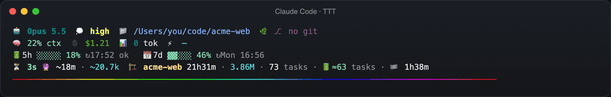
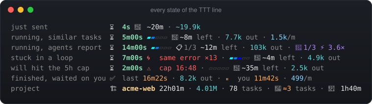
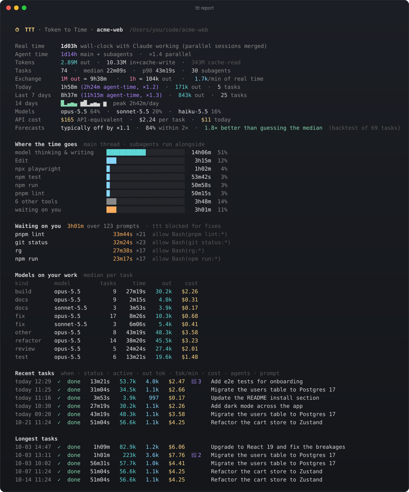
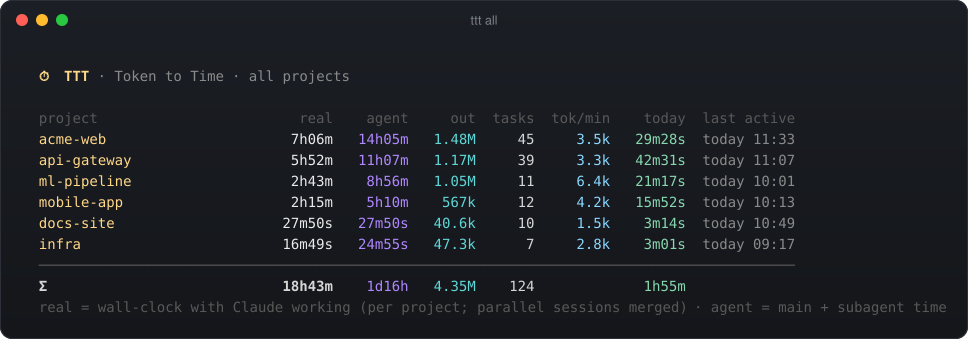
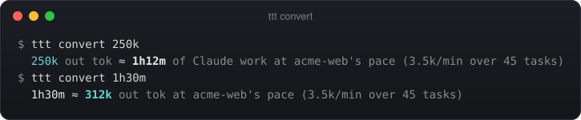
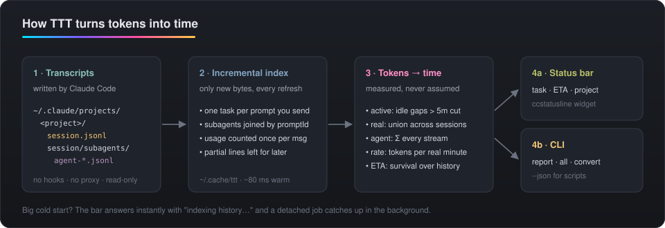

<div align="center">

# ⏱ TTT — Token to Time

**What do your Claude tokens cost you in real time?**<br>
Live in your Claude Code status bar: the task Claude is on right now, a forecast of when it'll finish, and the whole project's real time, tokens and exchange rate.

[](https://github.com/mysticalsin/TTT/actions/workflows/test.yml)




</div>

TTT adds **one line** to a [ccstatusline](https://github.com/sirmalloc/ccstatusline) bar like [tonys-tcc](https://github.com/mysticalsin/tonys-tcc), just above the rainbow rule. It also works on its own. It has no dependencies (only Node) and nothing to configure.

<p align="center"></p>

---

## Reading the bar

**Task segment.** "Task" means the prompt you just sent and everything it caused, including subagents.

| | |
|---|---|
| `⏳ 11m33s` | Active time on the current task. Green below your median task length, amber above it, red past your p90. |
| `▰▰▰▱▱▱ ~11m left` | **Forecast.** Of your past tasks that already ran this long, how much longer did they take? The bar shows progress against that median. |
| `past p90` | This task has outlived 90% of your history. Expect a long one. |
| `learning 3/5` | The project has fewer than 5 finished tasks. TTT borrows durations from your other projects until it has enough. |
| `64.1k out` | Tokens Claude generated for this task (main thread plus subagents, thinking included). |
| `🤖×3 ⚡2.1×` | 3 subagents. On average, 2.1 agents were working at once. |
| `✅ last 5m02s` | When idle, the bar shows the last finished task. `⏹` means you interrupted it; `💤` means it stalled (no activity for 30 min). |

**Project segment.** Everything ever run in this folder.

| | |
|---|---|
| `🏗 acme-web 7h14m` | **Real time**: wall-clock time with Claude working. Parallel sessions are merged, so they aren't double-counted. |
| `1.54M · 46 tasks` | Output tokens and number of tasks. |
| `14h05m agent` | Agent time: main thread plus all subagents. Shown when it's well above real time. |
| `today 36m` | Real time today. |
| `100k≈28m49s` | **Your exchange rate**: what a fixed chunk of tokens costs in real time in this project. It's measured, not assumed. |

The bar fits itself to the width ccstatusline gives it. When space is tight, it drops the least important parts first, starting with tok/min, then agent time and the exchange rate. Elapsed time and the ETA always stay.

---

## Commands

<p align="center"></p>

```bash
ttt report              # this project: real/agent time, tokens, exchange rate, 14-day sparkline,
                        # models, recent + longest tasks
ttt report ~/code/api-gateway --tasks 30
ttt all                 # every project ranked by real time, with a Σ row
ttt convert 250k        # 250k out tok ≈ 1h12m of Claude work at this project's pace
ttt convert 1h30m       # 1h30m ≈ 312k out tok
ttt report --json       # everything, machine-readable
ttt bar [task|project]  # what the status line runs (reads Claude Code's JSON on stdin)
```

<p align="center"></p>
<p align="center"></p>

---

## How it measures (and why the numbers are real)

<p align="center"></p>

Claude Code writes every turn to `~/.claude/projects/<project>/<session>.jsonl`. Each subagent gets its own file under `<session>/subagents/`. TTT reads only those files. It doesn't use hooks, a proxy or guesses.

- **Tasks.** A task starts at each prompt *you* send, or a slash command you run. Messages Claude receives on its own (background-task notifications, coordinator messages, system reminders) stay part of the task that caused them. Subagent entries carry the `promptId` of the prompt that spawned them, so attribution is exact.
- **Tokens.** One API response appears as several transcript entries (thinking, text, tool use), and each repeats the usage block. TTT counts each message once.
- **Active time.** Gaps over 5 minutes (`TTT_IDLE_MIN`) count as you being away or a permission prompt left open. They are cut out.
- **Real vs. agent time.** Real time is the union of active periods across all tasks and sessions. Agent time is each stream's (main thread or subagent) active time added up. Their ratio is your parallelism.
- **Forecast.** This is a survival estimate: the median remaining time among past tasks that were still running at this point. TTT also computes an 80th-percentile bound. It gets sharper as you use it.
- **Speed.** TTT keeps a byte offset per file, so each refresh reads only what was written since the last one. A warm refresh is about 80 ms, even on a 1.7 GB project. When there's more than 24 MB to catch up on, the bar returns immediately (`indexing history…`) and a detached job catches up. The cache lives in `~/.cache/ttt/`.

Token modes (`TTT_TOKENS`):
- `out` (default): what Claude generated.
- `work`: input, output and cache writes.
- `all`: also counts cache reads, which mostly measure how big the context is, not how much work was done.

---

## Install

```bash
git clone https://github.com/mysticalsin/TTT.git ~/Documents/Projects/TTT
cd ~/Documents/Projects/TTT && ./install.sh
alias ttt=~/.claude/bin/ttt   # add to ~/.zshrc to call it directly
```

The installer does three things:
- Links `~/.claude/bin/ttt` to `bin/ttt.mjs`.
- Adds one line to your ccstatusline config. It edits the text directly, so your hand formatting survives (the diff is exactly 4 lines). It writes through the tonys-tcc symlink and saves a backup to `~/.cache/ttt/backups/`.
- Warms the cache for all your projects in the background.

`./install.sh --uninstall` reverses it. The add→remove round trip returns a byte-identical file.

No ccstatusline? Point Claude Code straight at TTT:

```json
{ "statusLine": { "type": "command", "command": "~/.claude/bin/ttt bar", "padding": 0, "refreshInterval": 5 } }
```

## Environment

| var | default | |
|---|---|---|
| `TTT_TOKENS` | `out` | `out` \| `work` \| `all` |
| `TTT_IDLE_MIN` | `5` | Gaps longer than this aren't counted as work. Changing it triggers a re-index. |
| `TTT_STALL_MIN` | `30` | A task with no activity for this long counts as stalled. |
| `TTT_WIDTH` | `92` | Column budget for the TTT line. |
| `TTT_INLINE_MB` | `24` | Above this much unread transcript, the bar indexes in the background. |
| `NO_COLOR` | | Plain output. |

## Files

| path | what |
|---|---|
| `bin/ttt.mjs` | CLI entry point |
| `lib/indexer.mjs` | Incremental JSONL reader that folds entries into tasks and keeps the cache |
| `lib/model.mjs` | Active/real/agent time, rates, survival forecast |
| `lib/bar.mjs` | Status-line segments with width fitting |
| `lib/report.mjs` | `report` / `all` terminal reports |
| `lib/global.mjs` | Cross-project duration memory (for forecasts in new projects) |
| `scripts/statusline.mjs` | Format-preserving ccstatusline patcher |
| `scripts/visuals.mjs` | Rebuilds every image in `docs/` from synthetic demo projects (`npm run visuals`) |
| `test/` | `npm test` (node:test, fixture transcripts) |

> All screenshots are generated from synthetic demo projects (`npm run visuals`). None of them come from real transcripts.
