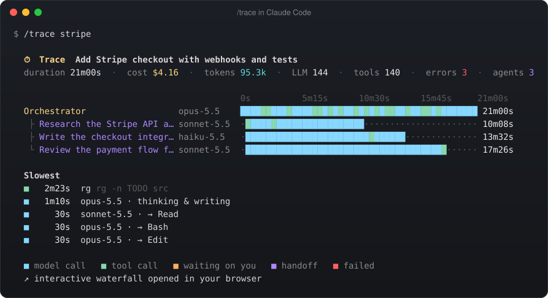
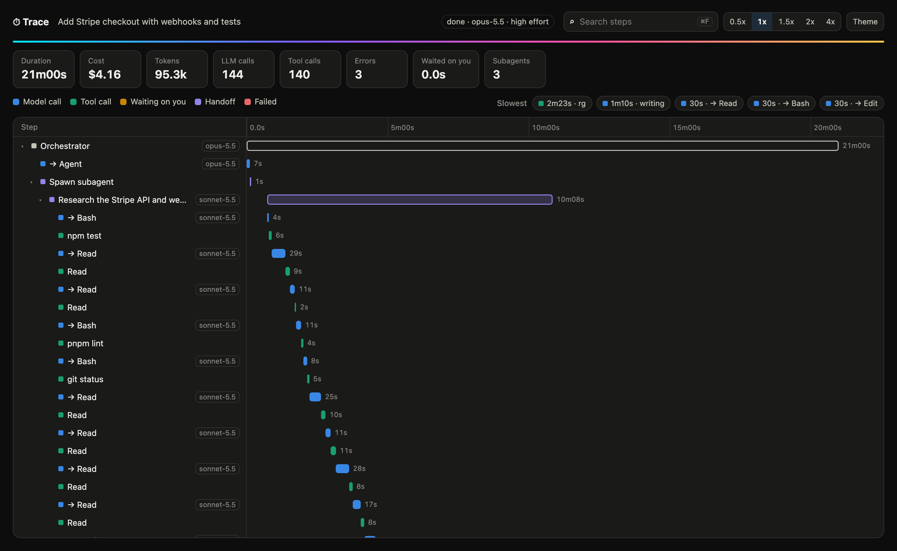
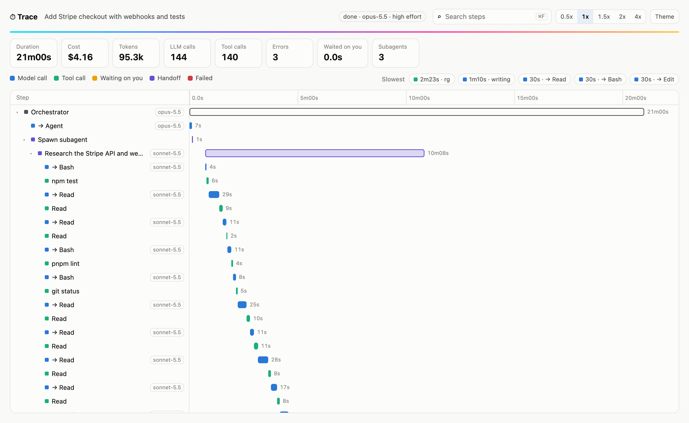
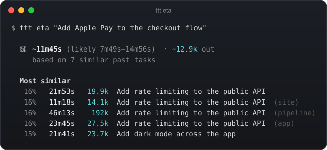
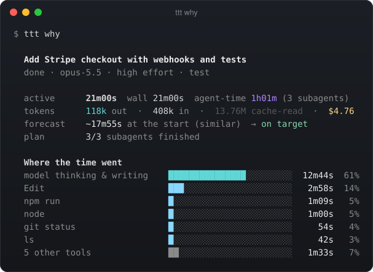
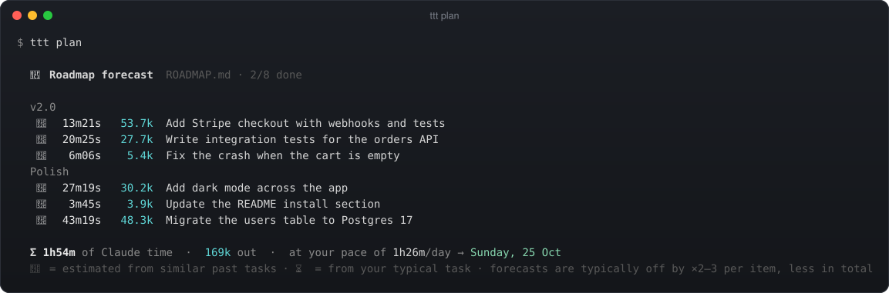
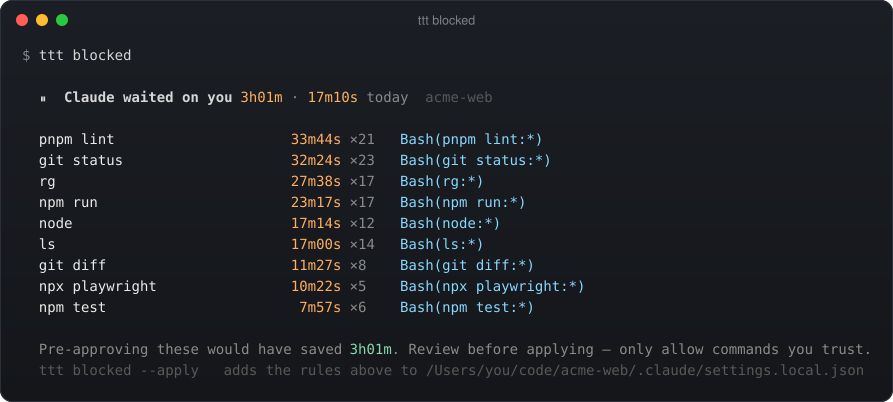
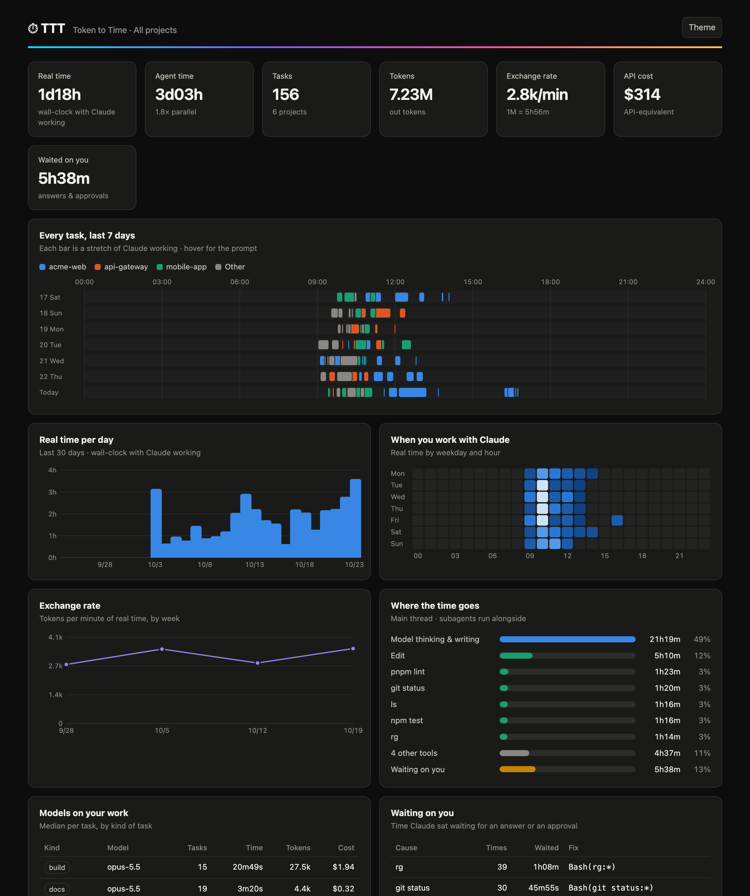
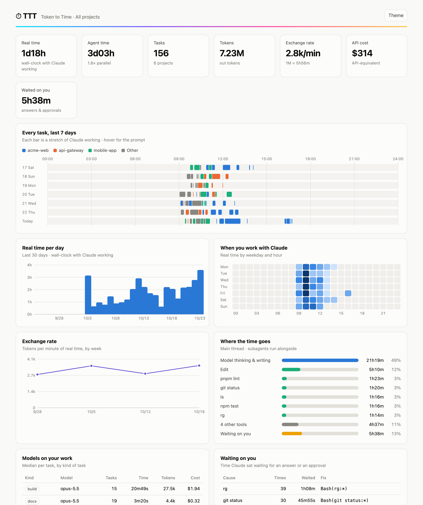

<div align="center">

# ⏱ TTT — Token to Time

**What do your Claude tokens cost you in real time, and how long will the next task take?**<br>
TTT puts it in your Claude Code status bar and keeps it to one line: the running task and its forecast, then the project's real time, your usage-limit runway and your roadmap.

[](https://github.com/mysticalsin/TTT/actions/workflows/test.yml)


</div>

**New in 2.1: [`/trace`](#trace--a-waterfall-of-any-task)**, a waterfall of any task (every model call, tool, wait and subagent) right inside Claude Code.

TTT adds **one line** to a [ccstatusline](https://github.com/sirmalloc/ccstatusline) bar like [tonys-tcc](https://github.com/mysticalsin/tonys-tcc), just above the rainbow rule. It also works on its own. It has zero dependencies (only Node) and nothing to configure. It reads the transcripts Claude Code already writes: no hooks, no proxy, nothing sent anywhere.

## What the line can say

<p align="center"></p>

| | |
|---|---|
| `⏳ 4s 🔮 ~20m · ~19.9k` | **Pre-flight.** The moment you hit enter, TTT estimates time and tokens from the most similar things you've asked before, across all your projects. |
| `▰▰▱▱▱ 🔮~8m left` | **Live ETA from similar tasks.** Your past tasks with similar prompts that had already run this long: how much longer did they take? The clock turns amber past your median and red past your p90. |
| `📋1/3 ~12m left` · `🤖1/3 ⚡3.6×` | **Plan burn-down.** When Claude splits the work into subagents (or a todo list), TTT extrapolates from how fast they finish. `⚡3.6×` means 3.6 agents working at once on average. |
| `🌀 same error ×13` | **Loop alert.** The same failing result over and over, the same call repeated, or no file edits in 12 minutes while tokens keep flowing. It also sends a notification so you can step in. |
| `⚠ cap 16:40` | **Usage-limit warning.** At your current burn rate, this task's forecast outlasts what's left of your 5-hour limit. |
| `⏸ you 11m42s` | **Time Claude spent waiting on you**: permission prompts and questions. |
| `🔋≈4 tasks` | **Runway.** How many of your typical tasks fit before the 5-hour cap, measured from how fast the limit drains *while Claude works*. |
| `🏁 1h40m` | **Roadmap.** All the open items in `TODO.md` / `ROADMAP.md`, each estimated from similar past tasks. |
| `🏗 acme-web 22h01m · 4.01M · 78 tasks` | **Project totals**: real wall-clock time (parallel sessions merged), tokens, and tasks. |

The line fits itself to the width it's given. When space is tight it drops the least important parts first (tok/min, the exchange rate, agent time…). The clock, alerts and ETA always stay.

**Walk-away mode.** When a task you left running for 3+ minutes finishes, or starts looping, you get a macOS notification. Set `TTT_VOICE=1` and [Sam](https://github.com/mysticalsin/tonys-tcc) says it out loud: *"Done. 21 minutes, 118 thousand tokens, 3 minutes faster than usual."*

---

## `/trace` — a waterfall of any task

Type **`/trace`** in Claude Code (or run `ttt trace` in a terminal) to see your last task as a waterfall:
- **What's in it:** every model call, tool call, wait on you, failure and subagent handoff, nested under the orchestrator, on one time axis.
- **In Claude Code:** you get a compact waterfall in the terminal, the interactive version opens in your browser, and Claude replies with a three-line read: the biggest time sink, what failed or waited on you, and one way to make it faster.
- **Picking a task:** `/trace 3` traces the third-last task; `/trace stripe` traces the last task whose prompt mentions "stripe".

<p align="center"></p>

The browser view shows:
- **Summary chips:** duration, cost, tokens, LLM calls, tool calls, errors, waited on you, subagents.
- **A collapsible span tree**, with each subagent nested under the handoff that spawned it.
- **Tools to find things:** `⌘F` search (with a "No matching steps" state), zoom from 0.5× to 4× (also `+` / `-`), a **Slowest** list that jumps to the span, and a click-to-inspect panel with the input, what Claude said, errors, tokens and cost.
- **Light and dark** themes.

It's one local HTML file with no network requests, so your prompts never leave your machine.

<table>
<tr>
<td width="50%"></td>
<td width="50%"></td>
</tr>
</table>

---

## Commands

```bash
ttt report               # the full picture for this project (below)
ttt eta "add Apple Pay"  # forecast a task before you send it
ttt why [n]              # where the time went in the last (or nth-last) finished task
ttt blocked [--apply]    # time Claude waited on you, and the allow-rules that stop it
ttt plan [file|--issues] # forecast your roadmap: TODO.md / ROADMAP.md, or GitHub issues
ttt trace [n|words]      # waterfall of a task (also /trace inside Claude Code)
ttt dashboard [--all]    # local visual dashboard in your browser
ttt all                  # every project ranked by real time
ttt convert 250k | 45m   # tokens ⇄ time at your measured pace
```

Every command takes `--json`, plus `--dir <project>` to point at another project.

<p align="center"></p>

<table>
<tr>
<td width="50%"></td>
<td width="50%"></td>
</tr>
</table>

<p align="center"></p>
<p align="center"></p>

### Dashboard

`ttt dashboard` writes one self-contained HTML file to `~/.cache/ttt/` and opens it. It shows:
- Every task as a timeline
- When you work, as a weekday × hour heatmap
- Real time per day
- The exchange-rate trend
- Where the time goes
- Model economics
- Waiting on you

It makes no network requests. Your prompts stay on your machine.

<table>
<tr>
<td width="50%"></td>
<td width="50%"></td>
</tr>
</table>

---

## How it measures (and why the numbers are real)

<p align="center"></p>

Claude Code writes every turn to `~/.claude/projects/<project>/<session>.jsonl`, and each subagent to `<session>/subagents/`. TTT reads those files and nothing else.

- **Tasks.** A task is one prompt *you* sent (or one slash command), plus everything it caused. Subagents are joined to it by the exact `promptId` that spawned them. Background notifications and system messages stay part of the task that caused them.
- **Tokens.** Each API message is counted once, even though the transcript repeats its usage on every content block. Costs are API-equivalent, from per-model prices with the 5-minute and 1-hour cache-write rates (override with `TTT_PRICES`).
- **Time.**
  - *Active:* gaps over 5 minutes are you, not Claude, so they're cut out.
  - *Real:* the union of active periods across sessions.
  - *Agent:* every stream's active time added up.
- **Where the time goes.** Every gap on the main thread is charged to whatever ended it: model output, a tool (Bash is labelled by its real command, e.g. `npm test`), or waiting on you. "Waiting on you" is exact, because the transcript records whether each tool call was approved by config or by a person.
- **Forecasts.** The estimate comes from the first source available:
  1. 📋 Claude's own plan, when it has one.
  2. 🔮 Similar past prompts, matched with TF-IDF across all projects (same-project, same-model and same-effort tasks weigh more), conditioned on how long the task has already run.
  3. ⏳ Survival over all your past tasks.

  **They're backtested.** Each past task is predicted from only what came before it, and the result is shown in `ttt report`. On 182 real tasks, similar-prompt matching typically missed by ×2.6, against ×4.6 for "guess the median". The backtest also sets the "likely" ranges `ttt eta` shows. If the forecasts in a project are no better than the median, the report says so.
- **Runway.** Every refresh samples your 5-hour limit. The burn rate is measured only while a task is running, then converted into tasks and a cap time.
- **Speed.** A byte-offset cache means each refresh reads only new bytes: about 80 ms warm, even on a 1.7 GB project. Big catch-ups run in a detached background job while the bar says `indexing history…`.

---

## Install

```bash
git clone https://github.com/mysticalsin/TTT.git ~/Documents/Projects/TTT
cd ~/Documents/Projects/TTT && ./install.sh
alias ttt=~/.claude/bin/ttt   # add to ~/.zshrc
```

The installer does three things:
- Links `~/.claude/bin/ttt` to the repo.
- Adds the `/trace` slash command to `~/.claude/commands/`. It never overwrites a `trace.md` that isn't TTT's.
- Adds one line to your ccstatusline config. It edits the text in place, so your formatting survives (the diff is exactly 4 lines). It writes through a tonys-tcc symlink and backs up to `~/.cache/ttt/backups/`.
- Warms the cache in the background.

`./install.sh --uninstall` reverses it byte-for-byte.

No ccstatusline? Use TTT directly:

```json
{ "statusLine": { "type": "command", "command": "~/.claude/bin/ttt bar", "padding": 0, "refreshInterval": 5 } }
```

## Environment

| var | default | |
|---|---|---|
| `TTT_TOKENS` | `out` | `out` (generated) \| `work` (+ input and cache writes) \| `all` (+ cache reads) |
| `TTT_IDLE_MIN` | `5` | Gaps longer than this aren't counted as work. Changing it triggers a re-index. |
| `TTT_STALL_MIN` | `30` | A task with no activity for this long counts as stalled. |
| `TTT_WIDTH` | `92` | Column budget for the TTT line. |
| `TTT_NOTIFY` / `TTT_NOTIFY_MIN` | `1` / `3` | Notifications on/off, and the minimum task length that triggers one. |
| `TTT_VOICE` | `0` | `1` speaks notifications (Sam if installed, else `say`). |
| `TTT_PLAN_FILE` | | A roadmap that lives outside the repo. |
| `TTT_PRICES` | | JSON price overrides, e.g. `{"opus-5.5":[4,20,0.2]}` (in, out, cache read per MTok). |
| `TTT_INLINE_MB` | `24` | Above this much unread transcript, the bar indexes in the background. |
| `NO_COLOR` | | Plain output. |

## Files

| path | what |
|---|---|
| `bin/ttt.mjs` | CLI |
| `lib/indexer.mjs` | Incremental JSONL reader: tasks, tokens, time breakdown, waits, plans, loop signals |
| `lib/model.mjs` | Active, real and agent time, rates, plan progress, loop detection |
| `lib/forecast.mjs` | Plan, similar-prompt and survival estimators, plus the backtest |
| `lib/similar.mjs` | TF-IDF prompt similarity and task kinds |
| `lib/limits.mjs` | 5-hour limit sampling, burn rate, runway |
| `lib/plan.mjs` | Roadmap parsing and project forecast |
| `lib/blocked.mjs` | Waiting-on-you causes and permission rules |
| `lib/pricing.mjs` | API-equivalent cost |
| `lib/notify.mjs` | Notifications and voice |
| `lib/dashboard.mjs` | The local HTML dashboard |
| `lib/trace.mjs` · `lib/trace-html.mjs` | `/trace`: span builder, terminal waterfall, browser waterfall |
| `commands/trace.md` | The `/trace` slash command (linked into `~/.claude/commands/`) |
| `lib/bar.mjs` · `lib/report.mjs` | Status line and terminal reports |
| `scripts/visuals.mjs` | Rebuilds every image in `docs/` from synthetic demo projects (`npm run visuals`) |
| `test/` | `npm test` (node:test) |

> All screenshots come from synthetic demo projects (`npm run visuals`). None of them come from real transcripts.
